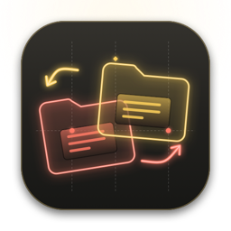

  

<h1 align="center">Muletto</h1>

  File manager a doppio pannello per macOS · Apple Silicon · macOS 13 o successivo 
  Dual-pane file manager for macOS · Apple Silicon · macOS 13 or later

  <a href="https://github.com/alecensi82/Muletto/raw/main/Muletto.dmg"><b>⬇ Scarica Muletto / Download Muletto</b></a> 
  <a href="CHANGELOG.md">Novità di ogni versione / What's new in each version</a>

---

## Italiano

Muletto è un file manager con **due pannelli indipendenti**: navighi due cartelle affiancate e sposti o copi i file trascinandoli da una parte all'altra. App firmata e notarizzata da Apple.

- **Doppio pannello** con schede, cronologia, percorso a capsule cliccabile e filtro rapido
- **Trascinamento** come nel Finder: stesso disco = sposta, altro disco = copia (⌥ copia, ⌘ sposta)
- **Copie e spostamenti** con avanzamento, annullamento e gestione dei file già esistenti
- **Dischi esterni e di rete** con barra di riempimento ed espulsione; connessione a SMB, AFP, NFS, FTP, WebDAV
- **Tag del Finder** colorati: assegnali dal menu, dall'Inspector o trascinando i file sul tag
- **Inspector**: anteprima (anche la prima pagina dei PDF), dati EXIF delle foto, durata e codec dei video, permessi modificabili
- **Vista a elenco o a icone** con miniature, Quick Look, rinomina multipla, comprimi ed estrai, confronto e sincronizzazione delle cartelle
- **Stile Arioso** con capsule flottanti, oppure stile Mac classico; temi colore, colore di evidenziazione e icona a scelta
- **Aggiornamenti automatici** da questa pagina

### Installazione
Apri `Muletto.dmg` e trascina Muletto in **Applicazioni**.

---

## English

Muletto is a **dual-pane file manager**: browse two folders side by side and move or copy files by dragging them across. Signed and notarized by Apple.

- Dual pane with tabs, history, clickable path and quick filter
- Finder-like drag and drop, file operations with progress and cancel
- External and network drives with usage bar and eject; SMB, AFP, NFS, FTP, WebDAV
- Coloured Finder tags, Inspector with previews, EXIF and editable permissions
- List or icon view, Quick Look, batch rename, archives, folder compare and sync
- Airy style with floating capsules or classic Mac style; themes, accent colours and alternative icons
- Automatic updates from this page

### Install
Open `Muletto.dmg` and drag Muletto to **Applications**.
